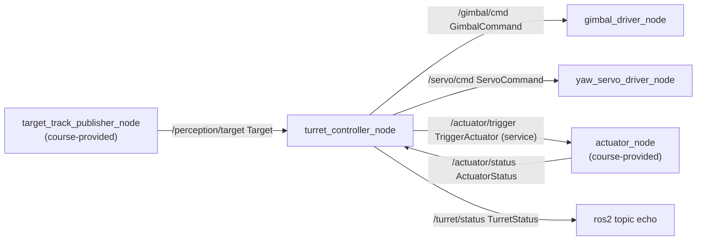

# ros_anti_drone_turret

A ROS 2 (Jazzy, C++20) system for a simplified anti-drone turret. A perception stream reports where an FPV drone is in the camera frame; a controller aims a gimbal and a yaw servo at it, and asks an actuator to fire (for example a net launcher) only when the target is confident enough, close enough, and the actuator is ready.

No real hardware is involved. The drivers only log the commands they receive, and the actuator simulates a reload delay.

## System



| Node | Owner | Role |
|---|---|---|
| `target_track_publisher_node` | course | Reads a CSV track and publishes each row as a `Target`. |
| `actuator_node` | course | Serves `/actuator/trigger`, counts shots, publishes `READY` or `RELOADING`. |
| `turret_controller_node` | student | Decides what to do with each target and drives the other nodes. |
| `gimbal_driver_node` | student | Receives vertical aim commands and logs them. |
| `yaw_servo_driver_node` | student | Receives horizontal aim commands and logs them. |

## Interfaces

| Name | Type | Fields |
|---|---|---|
| `/perception/target` | `msg/Target` | `visible`, `x`, `y`, `distance_m`, `confidence` |
| `/actuator/status` | `msg/ActuatorStatus` | `state` (`READY=0`, `RELOADING=1`), `trigger_count` |
| `/actuator/trigger` | `srv/TriggerActuator` | request `confidence`, `distance_m`; response `accepted`, `trigger_count` |
| `/gimbal/cmd` | `msg/GimbalCommand` | `direction` (`DOWN=-1`, `CENTER=0`, `UP=1`), `target_y`, `error_y` |
| `/servo/cmd` | `msg/ServoCommand` | `direction` (`LEFT=-1`, `CENTER=0`, `RIGHT=1`), `target_x`, `error_x` |
| `/turret/status` | `msg/TurretStatus` | `target_state`, `action`, `trigger_state`, `confidence`, `distance_m` |

## Controller logic

All decisions live in `include/antidrone_turret/target_track_decisions.hpp`, plain C++ with no ROS dependency, so it is unit tested without a ROS graph. `turret_controller_node` only converts messages to these types and back.

**Decision** (`decide`), checked in this order:

| Condition | Confidence | Action | Trigger |
|---|---|---|---|
| target not visible | `NONE` | `IDLE` | `SKIP` |
| `confidence < confidence_threshold` | `LOW` | `IDLE` | `SKIP` |
| `distance_m > max_distance_m` | `HIGH` | `TRACK` | `SKIP` |
| actuator is `RELOADING` | `HIGH` | `TRACK` | `RELOADING` |
| otherwise | `HIGH` | `TRACK` | `REQUESTED` |

A confidence exactly at the threshold counts as good, and a distance exactly at the maximum counts as in range. Low confidence wins over reloading, so an unreliable target never reports a reload.

**Aiming** uses a simplified frame of 640 x 480 with the centre at (320, 240). `x` grows to the right and `y` grows downwards:

- `error_x = x - width / 2`: positive means `RIGHT`, negative means `LEFT`, zero means `CENTER`.
- `error_y = height / 2 - y`: positive means `UP`, negative means `DOWN`, zero means `CENTER`. The sign is flipped because `y` grows downwards, so a target above the centre needs the gimbal to go up.

Aim commands are published only while the action is `TRACK`. When the target is not visible or not confident, nothing is sent to the drivers. `/turret/status` is published for every incoming target.

**Firing:** when the trigger is `REQUESTED`, the controller calls `/actuator/trigger` asynchronously with the target's confidence and distance and logs the response. While the actuator is `RELOADING` the controller does not request a shot. If it did, the actuator would reject it.

## Parameters

Set in `config/sequence.yaml`:

| Node | Parameter | Default | Meaning |
|---|---|---|---|
| `target_track_publisher_node` | `publish_hz` | `5.0` | Rate at which track rows are published |
| `target_track_publisher_node` | `repeat_sequence` | `true` | Loop the track forever |
| `actuator_node` | `reload_ms` | `1500` | Time spent in `RELOADING` after a shot |
| `actuator_node` | `status_publish_hz` | `2.0` | Status publish rate |
| `turret_controller_node` | `confidence_threshold` | `0.8` | Minimum confidence to lock on |
| `turret_controller_node` | `max_distance_m` | `30.0` | Maximum distance at which to fire |
| `turret_controller_node` | `screen_width`, `screen_height` | `640.0`, `480.0` | Frame size used for aiming |

## Tracks

CSV files in `robot_ws/src/antidrone_turret/tracks/`, one row per message (`visible,x,y,distance_m,confidence`). By default all four play in sequence, with an invisible row between episodes.

| File | What it exercises |
|---|---|
| `approach_trigger.csv` | A drone approaches the turret. The controller should fire once it is within range. |
| `far_flyby_no_trigger.csv` | Confident detection that never gets close enough. It tracks but never fires. |
| `low_confidence_no_trigger.csv` | Close, but confidence stays below 0.8. No lock, no fire. |
| `reload_pressure.csv` | Two close episodes in a row. The second arrives while the actuator is still reloading, so the shot must be skipped. |

## Build and run

The project is meant to run inside its devcontainer, which is based on `osrf/ros:jazzy-desktop` with CycloneDDS. Open the folder in VS Code and choose "Reopen in Container".

```sh
cd robot_ws
source /opt/ros/jazzy/setup.bash
colcon build --cmake-args -DCMAKE_BUILD_TYPE=Debug
source install/setup.bash

ros2 launch antidrone_turret system.launch.py
ros2 launch antidrone_turret system.launch.py track:=reload_pressure.csv
ros2 launch antidrone_turret system.launch.py log_level:=debug
```

Launch arguments: `track` (a CSV file name, or `all`), `profile` (a YAML file in `config/`, default `sequence.yaml`) and `log_level`.

To watch what the controller decides:

```sh
ros2 topic echo /turret/status
ros2 topic echo /servo/cmd
ros2 topic echo /gimbal/cmd
ros2 topic echo /actuator/status
```

**Tests:**

```sh
colcon test --packages-select antidrone_turret
colcon test-result --verbose
```

- `provided_logic_test` covers the course-provided code: CSV loading and validation, the target sequence, and the actuator's `READY`, `RELOADING`, `READY` cycle with rejection of repeat shots.
- `target_track_decisions_test` covers the decision table and the servo and gimbal error calculations, including the boundary cases (exactly at the threshold, exactly at the maximum distance, exactly at the centre).

## VS Code

- Tasks: `ROS2: colcon build` and `ROS2: build + launch system` (the default build task).
- Debug configurations for `actuator_node` and `target_track_publisher_node` under GDB.
- clangd reads `robot_ws/build/compile_commands.json`, so run a colcon build first for the ROS headers to resolve.

## Layout

```text
.devcontainer/          ROS 2 Jazzy image, CycloneDDS config, post-start daemon reset
.vscode/                tasks, launch configs, clangd settings
docs/ASSIGNMENT.md      original course assignment (Ukrainian)
robot_ws/src/antidrone_turret/
  msg/  srv/            interface definitions
  include/antidrone_turret/
    target_track_decisions.hpp   controller logic (student)
    actuator_model.hpp, target_sequence.hpp,
    target_track_loader.hpp, target_track_simulation.hpp   course-provided
  src/                  the five node executables
  test/                 gtest suites
  tracks/  config/  launch/
```

The course-provided files must not be edited: `target_track_publisher_node.cpp`, `actuator_node.cpp`, the `actuator_model`, `target_sequence`, `target_track_loader` and `target_track_simulation` headers, `provided_logic_test.cpp` and the CSV tracks. The student-owned files are the controller, both driver nodes, `target_track_decisions.hpp` and its test.
